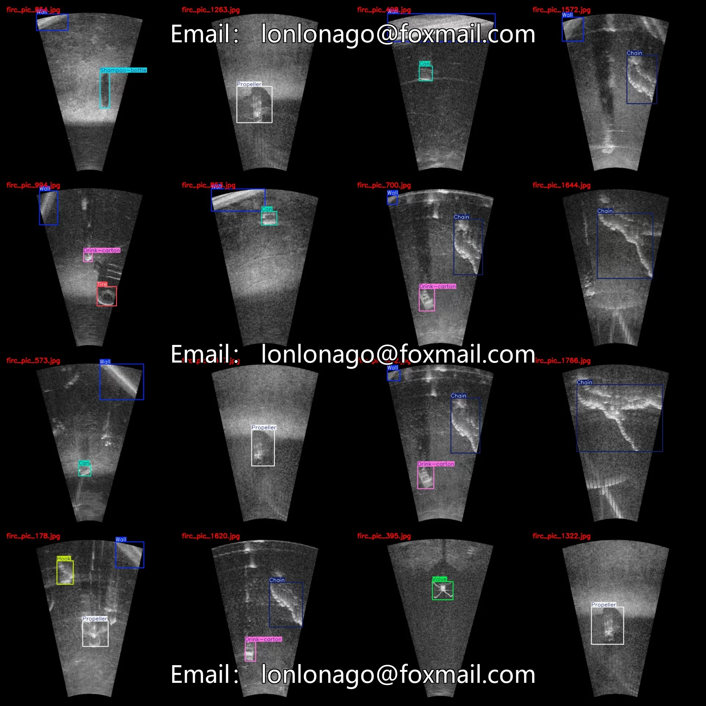
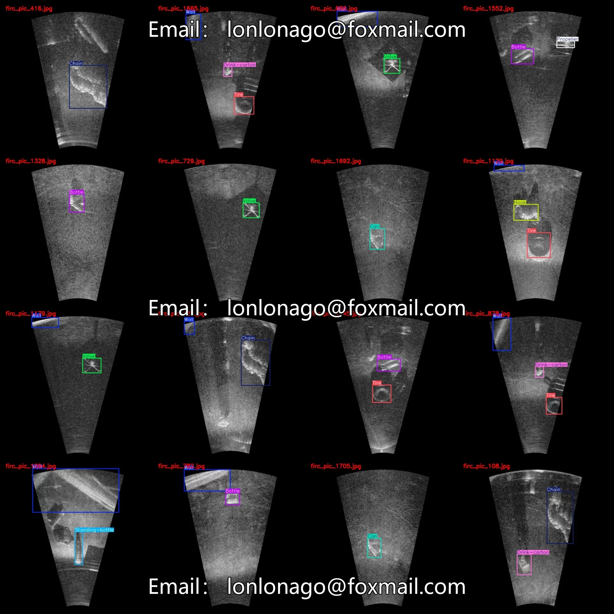
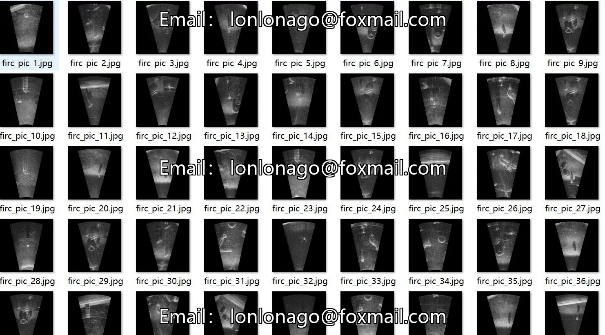
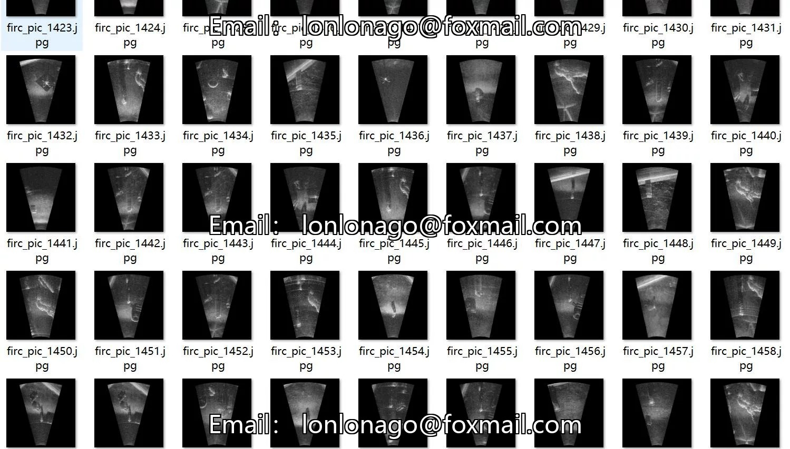
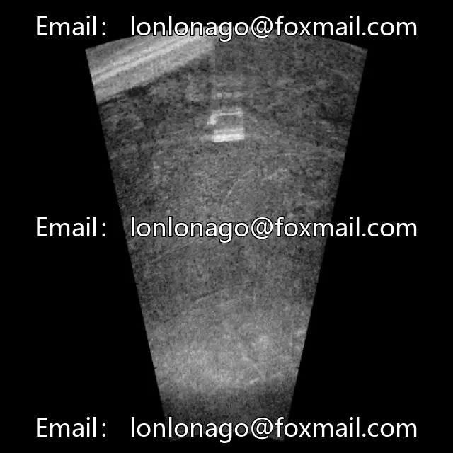
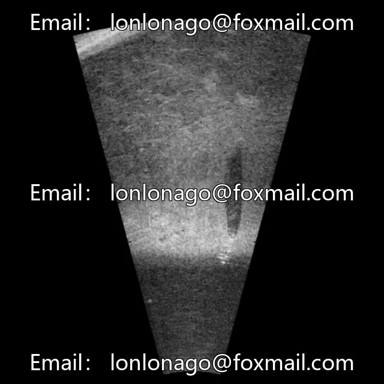
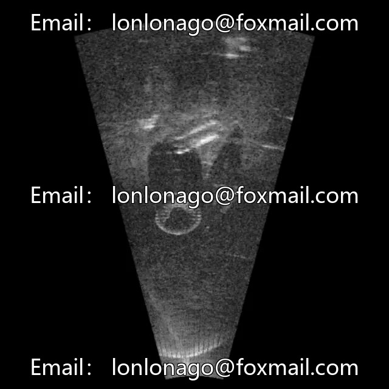

# Front-looking sonar FLS underwater target detection dataset VOC+YOLO format 1868

## Body

Augmented VOC+YOLO dataset for underwater object detection with 1868 images in 11 categories
Please note: Due to the dataset's replicability, after purchase, please confirm compliance before purchasing.
Dataset format: Pascal VOC format + YOLO format (txt file without split path, only containing jpg images and corresponding VOC format xml files and yolo format txt files)
Number of images (number of jpg files): 1868
Number of annotations (number of xml files): 1868
Number of annotations (number of txt files): 1868
Number of annotation categories: 11

Label category names (Note that the order of yolo format categories does not correspond to this, but is based on the classes.txt in the labels folder): ["Bottle", "Can", "Chain", "Drink-carton", "Hook", "Propeller", "Shampoo-bottle", "Standing-bottle", "Tire", "Valve", "Wall"]
Number of boxes and the number of images occupied by each category
Bottle (bottles) Frames = 468, Image Count = 416
Can (jar) frame count = 292, occupy picture count = 292

Chain (chain) Frame Count = 320, Image Count = 313
Drink-carton (drink carton) Frame Count = 347, Image Count = 347
Hook (hook) Frame Count = 171, Image Count = 170
Propeller (propeller) Frame Count = 197, Image Count = 197
Shampoo-bottle (shampoo bottle) Frame Count = 111, Image Count = 109
Standing-bottle (standing bottle) Frame Count = 65, Image Count = 65
Tire (tire) Frame Count = 615, Image Count = 615

Valve (Valve) Frames = 240, Image Count = 237
Wall (Wall) Frames = 1056, Image Count = 915
Total Frames: 3882
Image Resolution: 640x640
Labeling Tool: labelImg
Labeling Rules: Draw a rectangle around the category.
Important Note: The dataset does not have separate training, validation, and test sets; you need to partition them yourself.
Special Remark: This dataset does not guarantee the accuracy of the trained models or weight files.

## Images

## Payment

Here is a pay link on Stripe ( https://buy.stripe.com/3cs8yP7sY87d0vu9AB ). Please contact me lonlonago@foxmail.com after funding $89, and I will send you a complete data files , thank you!

